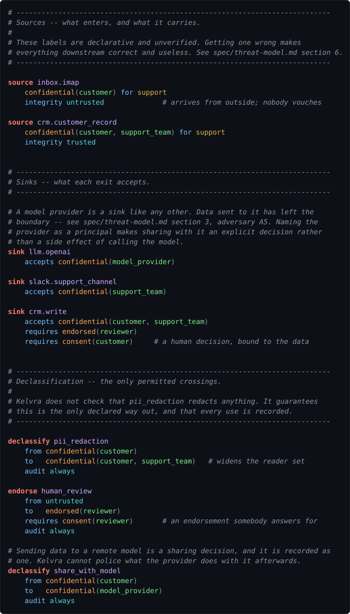

<p align="center">
  
</p>

<h1 align="center">Kelvra</h1>

<p align="center">
  <strong>Declare what an AI agent may know. Prove what it did.</strong>
</p>

<p align="center">
  A policy language and audit format for information flow in LLM agent pipelines.
</p>

<p align="center">
  <a href="#status">Status</a> ·
  <a href="#the-problem">Problem</a> ·
  <a href="#what-kelvra-is">What it is</a> ·
  <a href="#a-first-look">A first look</a> ·
  <a href="#prior-art">Prior art</a> ·
  <a href="#what-kelvra-does-not-guarantee">Limits</a> ·
  <a href="#roadmap">Roadmap</a> ·
  <a href="#license">License</a>
</p>

<p align="center">
  <a href="https://github.com/NICE-DEV226/kelvra/actions/workflows/ci.yml"></a>
  
  
  
</p>

---

## Status

**Early. Policies parse and enforce, and produce an audit record. Nothing is deployable.**

What exists:

- the [label model](spec/labels.md) — the algebra and the flow rule, written to be implemented without reading the code,
- the [`.klv` language](spec/policy-language.md) — grammar, semantics, and the diagnostic each malformed case must produce,
- the [provenance record](spec/provenance.md) and its [JSON schema](spec/provenance.schema.json) — the audit artifact, including its mapping onto OpenTelemetry GenAI spans,
- the [threat model](spec/threat-model.md) — who this defends against, and explicitly who it does not,
- the [known limitations](LIMITATIONS.md) — what is unbuilt, unverified, or unresolved,
- a reference implementation whose core has no third-party dependencies (the language server, signing with Ed25519 and sealing each need an optional extra), whose test suite executes every worked example in the specifications,
- a [gateway](spec/gateway.md) for MCP over stdio (`kelvra gateway`), tested against the official SDK's client and server and against real JSON decoders, and a signed, hash-chained provenance record with a write-ahead journal,
- an [adversarial evaluation](evaluation/) against a corpus of real indirect prompt injections — six attacks, five expressible as a data flow and all five contained, no false positives on three benign controls, and one attack it explicitly cannot see.

What does not exist: OpenTelemetry emission, imports in `.klv`, an HTTP transport for the gateway, a trial of the gateway with a real MCP application, and any deployment anyone should rely on.

There is nothing to `pip install` from an index. If you want to argue with the design before it hardens, now is when that is worth most.

## The problem

An LLM agent reads data, calls tools, and writes to systems. In current frameworks there is no structural answer to a simple question:

> **Was this specific piece of data allowed to end up here?**

Indirect prompt injection — an attacker placing instructions inside an email, a web page, or a document the agent will read — is ranked LLM01 in the OWASP Top 10 for LLM Applications and is widely described as an unresolved architectural problem: a language model processes everything as one token sequence, with no reliable privilege boundary between the system prompt, the user's request, and retrieved content.

Commercial tooling answers with heuristics: injection classifiers, pattern-based PII redaction, runtime guardrails. These help, and they fail by construction on the cases they were not trained on.

The structural answer is **information flow control** (IFC), a field with roughly fifty years of results behind it. Kelvra does not try to reinvent it.

## What Kelvra is

Kelvra is **not another IFC engine**, and deliberately so — see [prior art](#prior-art). It is the layer above them:

| Artifact | Role |
|---|---|
| **Label vocabulary** | A portable way to express confidentiality, integrity, and purpose. Engine-independent. |
| **Policy language (`.klv`)** | The readable surface. Written by a developer, **reviewable by a compliance officer or an auditor.** |
| **Provenance record** | A signed, machine-readable record of every flow an agent run actually took. |
| **Reference implementation** | One implementation among others. Intentionally not the only one. |

**Your code does not move.** The intent is that Kelvra attaches to an existing Python / LangChain / MCP agent and describes what it is allowed to do, with nothing to rewrite and no framework to adopt. Today that means calling the Python API (`read`, `model_call`, `emit`); there is no MCP or framework adapter yet. Give the agent only the `AgentSession`: `declassify` and `endorse` stay with whoever builds the pipeline.

### Why a specification language, not a programming language

Kelvra is still a language. It is not a language that executes.

- **What we want to constrain isn't ours.** The computation happens inside a model we don't control, in frameworks we didn't write, calling tools we didn't build. A language that executes must own the whole stack. A constraint layer attaches to what already exists.
- **The value is in being read, not run.** Execution is now a commodity. A file a non-programmer can open and validate as their organization's actual policy is not.
- **Adoption economics.** A programming language demands a rewrite. A policy file sits next to your code.
- **A spec outlives an implementation.** SQL outlived System R. A compiler maintained by one person dies with that person.

The precedent is TypeScript, which never executes anything — `tsc` erases every annotation and emits JavaScript. Its entire value is being read, then vanishing. It won *because* it never asked anyone to rewrite their JavaScript.

## A first look

This parses and runs. It is [the actual policy](examples/support_agent/policy.klv) the demo enforces — not an illustration kept in step by hand. The syntax is **not final**.

<p align="center">
  
</p>

<details>
<summary>The same policy as text, to copy</summary>

```kelvra
policy SupportAgent
version 1

principal customer, support_team, reviewer, model_provider
purpose   support

source inbox.imap
    confidential(customer) for support
    integrity untrusted              # arrives from outside; nobody vouches

source crm.customer_record
    confidential(customer, support_team) for support
    integrity trusted

sink llm.openai
    accepts confidential(model_provider)

sink slack.support_channel
    accepts confidential(support_team)

sink crm.write
    accepts confidential(customer, support_team)
    requires endorsed(reviewer)
    requires consent(customer)     # a human decision, bound to the data

declassify pii_redaction
    from confidential(customer)
    to   confidential(customer, support_team)   # widens the reader set
    audit always

endorse human_review
    from untrusted
    to   endorsed(reviewer)
    requires consent(reviewer)       # an endorsement somebody answers for
    audit always

declassify share_with_model
    from confidential(customer)
    to   confidential(model_provider)
    audit always
```

</details>

About fifty lines. An auditor can read them and establish: three constrained exits; three crossings, each named — two that widen a reader set and one that grants an endorsement; and who must consent to the endorsement and to the CRM write. The agent's Python is untouched.

Two axes matter here, not one:

- **Confidentiality** — a set of principals allowed to read, plus a purpose. A lattice, not a `low/medium/high` scale, because "readable by the care team, for treatment purposes" does not project onto a linear axis.
- **Integrity** — who vouches for the data. This is the axis that describes prompt injection: untrusted content reaching a control decision is an *integrity* violation. A confidentiality-only model cannot express the attack that matters most.

`declassify` and `endorse` are the two places where something can go wrong, so they are the two places that get dedicated syntax and a mandatory audit entry. These are the standard terms from the IFC literature, used deliberately.

### Checked before anything runs

```console
$ kelvra check policy.klv
policy.klv  (SupportAgent v1)
warning[untrusted-reaches-sink] sink 'slack.support_channel': reachable by untrusted data
  from 'inbox.imap', with no endorsement or consent required
  hint: if this sink takes an action rather than just recording one, injected content
        can drive it. Add 'requires endorsed(...)' or 'requires consent(...)'
```

That is the shape of the attack, spotted at authoring time by reading the policy graph — no execution, no traffic, no incident. Errors look the same: delete the `requires consent(reviewer)` line under `endorse human_review` and `check` fails with `error[unguarded-endorsement]`, because an endorsement nobody answers for turns untrusted data into endorsed data automatically.

The reachability findings are **definite**: the analysis reports a problem only when no execution can avoid it, and stays silent otherwise (checked against an exhaustive search of every source subset and declassifier order on randomly generated small policies). It is allowed to miss things; it is not allowed to invent them. A checker that cries wolf gets switched off, and a switched-off checker protects nothing. Warnings exit 0 so they never break a build by surprise; `--strict` and `--json` are there for the pipelines that want more.

`kelvra explain policy.klv` prints the reachability table and names every declassifier — the complete list of places a leak is possible.

### From Python

```python
from kelvra import Denied, Kelvra, approved_by, parse_file, verify_record

KEY = b"change-me-this-key-is-32-bytes!!"  # at least 16 bytes; keep it out of the agent
k = Kelvra(
    parse_file("examples/support_agent/policy.klv"),
    signing_key=KEY,
    consent=approved_by("dr.martin"),  # a real deployment asks a human and names them
)
agent = k.agent_session()  # all the agent ever holds: read, model_call, emit

email = agent.read("inbox.imap", "Hi, my order is late.")  # confidential and untrusted
reply = agent.model_call("agent.reply", email, produce=lambda e: f"re: {e}")
try:
    agent.emit("crm.write", reply)  # untrusted data reaching a privileged sink
except Denied as denied:
    print(denied)  # flow to 'crm.write' denied: ... sink requires endorsement by reviewer ...

# Whoever builds the pipeline -- never the agent -- can take a declared crossing.
# Each one is recorded, and `human_review` asks the consent provider first.
reviewed = k.declassify("human_review", k.declassify("pii_redaction", reply))
agent.emit("crm.write", reviewed)

record = k.record()  # closes the run: one run, one record
print(verify_record(record, KEY).ok)  # True: well formed, chained, signed
```

`declassify` stays on `k`, not on the session, because it is the one operation that relaxes a label. The session is a capability boundary inside one process, not a sandbox: it keeps the *ordinary* route closed, and a process boundary (an adapter) is what keeps the rest closed.

### Behind an MCP server

```console
$ kelvra gateway --policy policy.klv --config tools.json -- python my_mcp_server.py
```

An agent that can simply not call a library is not constrained by it, so the [gateway](spec/gateway.md) sits between an MCP client (on stdin/stdout) and the server. Every `tools/call` is checked against the label of the conversation so far *before it reaches the tool*, every result is folded into that label *before it reaches the client*, and a tool the configuration does not name is refused. It is coarse on purpose — a proxy sees calls and results, not the model's context — and stdio-only. [spec/gateway.md](spec/gateway.md) lists, plainly, what it does not cover.

### In your editor

`kelvra lsp` speaks the [Language Server Protocol](https://microsoft.github.io/language-server-protocol/), so the findings above appear under the offending line as you type, in any editor that speaks it — VS Code, Neovim, Zed, Helix, Emacs. One server rather than one plugin per editor.

Hovering a sink answers the question a reviewer actually opens the file to ask:

> **sink `crm.write`**
> - accepts: `customer,support_team`
> - requires endorsement by: `reviewer`
> - requires consent from: `customer`
>
> **Reachable by**
> - `crm.customer_record` (directly)
> - `inbox.imap` (after declassification)

Install with `pip install "kelvra[lsp]"`. The core still has no dependencies; only the server needs one.

### The output that matters

Each run emits a provenance record — signed when you give it a key, and Kelvra warns when you do not — covering flows taken, declassifications used, consents granted, and **flows denied**. Machine-readable for tooling, summarizable to one page for an auditor. For a compliance team facing a traceability obligation, this record is the product; the policy file is how you configure it.

Two rules from [its specification](spec/provenance.md) are worth stating here, because both are easy to get wrong in a way nobody notices:

- **The record never contains the data it describes.** No message bodies, no tool arguments, no model output. A log of who touched confidential data, which itself contains that data, is a second copy of the problem — one shipped to auditors and retained for years.
- **The policy cannot change during a run.** Otherwise a record attests to policy *A* while some flows were checked against *B*, under a signature. A misleading record that looks authoritative is worse than no record. The session's policy is read-only, and `record()` refuses to sign if it no longer matches the fingerprint taken at the start.
- **Events are chained.** Each carries a sequence number and the hash of the one before it, so a deleted, reordered or truncated event breaks the record even before anyone checks a signature (`verify_record`).

Two things make the record usable after the fact. A **journal** (`Kelvra(..., journal_path=...)`) writes each event to disk as it happens, so a crashed run still leaves evidence and a finished one can be rebuilt. And an **Ed25519 signature** (`pip install "kelvra[sign]"`, `Ed25519Signer`) lets an auditor verify with a public key alone, which HMAC cannot do.

For live telemetry, the record maps onto [OpenTelemetry GenAI](https://opentelemetry.io/docs/specs/semconv/registry/attributes/gen-ai/) spans rather than inventing a transport. Those conventions are still pre-stable, which is also the opening: a label extension has a real chance upstream while they are in development.

## Sealing: ciphertext for the model

A pipeline that calls an external model has to put something in the prompt. For a value the policy
keeps from the provider, Kelvra can put an authenticated ciphertext there instead. The provider (and
anything the model is talked into doing) holds data it cannot read and a key it never had. The
plaintext comes back only when the model's output reaches a sink, and only if the flow rule accepts
the value's **original** label for that sink.

```bash
pip install -e ".[seal]"
python examples/sealed_support_agent/demo.py
```

The demo shows what the provider receives (the customer's question in clear, the account details
sealed), then an injected model trying six things, each refused and recorded, then the signed record
verifying. It runs offline; `--model http` points it at an OpenAI-compatible endpoint with a key you
supply.

What this is: AES-256-GCM and HKDF-SHA256 from the `cryptography` package, bound to the run, the
policy, the kind and the label so a token cannot be relabelled or moved. Nothing is invented; see
[the cryptographic design](spec/sealing-cryptographic-design.md) and the
[threat model](spec/sealing-threat-model.md).

What it is **not**: the model cannot compute on a sealed value, only carry it. Code running in the
same process can reach the key. There is no key rotation yet. It has been run against real models from Gemini and Groq: no leak in 147
valid trials, but whether a reply gets through depends on the model copying a token exactly (from 100% to
about 10% of replies, small samples, one day; [the numbers](spec/sealing-verification.md)).
[LIMITATIONS.md](LIMITATIONS.md#what-sealing-does-not-do) lists the rest.

## Prior art

Kelvra exists downstream of real work. Anyone evaluating this project should read these first:

- **[CaMeL](https://arxiv.org/abs/2503.18813)** — *Defeating Prompt Injections by Design* (Google DeepMind, 2025). Attaches capabilities to every value, separates control flow from data flow inside a restricted interpreter.
- **[FIDES](https://arxiv.org/abs/2505.23643)** — *Securing AI Agents with Information-Flow Control* (Microsoft Research, 2025). Confidentiality **and** integrity labels, deterministic policy enforcement, selective hiding and revealing primitives.
- **[FORGE / PCAS](https://arxiv.org/abs/2602.16708)** — Datalog policy compilation with a reference monitor and cross-agent provenance (2026).
- **[AgentArmor](https://arxiv.org/abs/2508.01249)** — treats agent runtime traces as structured programs: control and data flow graphs, a property registry, and a **type system** enforcing security policies. Attack success reduced to 3% on AgentDojo for a 1% utility cost. **The closest neighbour to this project.**
- **[NeuroTaint](https://arxiv.org/abs/2604.23374)** — taint tracking that treats propagation as semantic transformation and causal influence rather than string matching (2026).
- **[IPIGuard](https://arxiv.org/abs/2508.15310)** — plans a tool dependency graph before execution and refuses calls outside it, separating planning from data interaction (EMNLP 2025). A deterministic cousin of declaring your sinks in advance.
- Classic IFC: Denning's lattice model (1976), the [Jif](https://www.cs.cornell.edu/jif/) decentralized label model, and Sabelfeld & Sands on **declassification** — the framing this project's core primitive is built on.

**These systems already solve the enforcement problem, and better than a solo project will.** What none of them provides is an interoperable label vocabulary, a policy surface a non-programmer can read, or an audit artifact designed to be handed to a regulator. That gap is where Kelvra sits, and it is why Kelvra aims to compile *toward* these engines rather than compete with them.

If you know of work that closes this gap already, please open an issue. That is genuinely the most useful contribution right now — this project has twice claimed a gap that turned out to be occupied, and both times an outside reader would have caught it sooner. See [LIMITATIONS.md](LIMITATIONS.md).

## What Kelvra does not guarantee

Stated up front, permanently, because a security project that oversells is worth less than one that doesn't exist.

Kelvra does **not** claim an agent "cannot leak." Published defences in this space have become genuinely strong — [AgentArmor](https://arxiv.org/abs/2508.01249) reports attack success reduced to 3% on AgentDojo for a 1% utility cost — but strong is not total, and more importantly Kelvra is not making the same kind of claim. It is not a detector and publishes no detection rate. The honest claim is narrower and different in kind:

> In an agent governed by Kelvra, there is a **finite, enumerated** set of points where sensitive data can leave. Every one is named, every crossing is logged, and those that require it are gated on explicit consent. There is no undeclared path.

The [evaluation](evaluation/) is where that claim meets an actual corpus, including one attack it demonstrably cannot see.

Specifically, Kelvra does not:

- verify what a language model produces — if an authorized summary contains something it shouldn't, Kelvra will not see it. One attack in the corpus is exactly this, and it gets through;
- guarantee that a redaction function actually redacts — only that it is the sole declared crossing, and that its use is recorded;
- detect covert channels (timing, output length, steganographic encoding);
- stop a hostile developer — someone who declassifies everything gets a valid program, one whose policy file shows in plain text that it declassifies everything;
- protect data after it leaves the process boundary.

Full detail, including the six adversaries considered and the three placed explicitly **out of scope**, is in the [threat model](spec/threat-model.md). The trust base — and its known weakest link, declarative source labeling — is documented there too.

## Roadmap

**Phase 0 — Specification** *(drafted; still moving)*
Threat model, label vocabulary, provenance format.

**Phase 1 — Observation**
Instrument an existing agent *without enforcing anything*. Label sources, propagate, emit the provenance record. This is immediately useful to a compliance team, and it produces the real flow data needed to design the language against observed behavior rather than imagined syntax.

**Phase 2 — Declaration** *(current: parser, analysis, language server and reference runtime exist)*
The MCP boundary now exists as a stdio gateway; what remains is trying it with a real MCP application, an HTTP transport, and the open design problems in [LIMITATIONS.md](LIMITATIONS.md). The language server came before it deliberately: for most languages an LSP is a convenience, but here the diagnostics *are* the security tool — telling someone in their editor that a flow can never be permitted delivers the whole value proposition at authoring time, before anything runs.

**Phase 3 — Standardization**
Publish the vocabulary and record format as an implementation-independent specification, and seek a home for it. This is the phase that decides whether the project matters.

**Phase 4 — Native engine** *(optional, possibly never)*
A standalone static checker. Only if Phase 3 succeeds and demand justifies it.

No dates. This is an early-stage project moving in public, not a funded roadmap with commitments.

## Contributing

There is a small reference implementation, but no adapter yet, and the specification is still moving. What is genuinely useful:

- **prior art we've missed** — especially anything that already closes the gap described above,
- pushback on the [threat model](spec/threat-model.md), particularly on what's been placed out of scope,
- whether the label model survives contact with a real pipeline you've built,
- from anyone in compliance, audit, or DPO work: whether the provenance record is the artifact you'd actually want.

Open an issue. Please discuss before opening PRs against the spec — it is still moving.

Security disclosures: see [SECURITY.md](SECURITY.md).

## License

Dual licensed under **[MIT](LICENSE-MIT) OR [Apache-2.0](LICENSE-APACHE)**, at your option — the convention used across the Rust ecosystem and much of modern systems tooling. Apache-2.0 is included specifically for its explicit patent grant, which matters for a project intended to be implemented by third parties.

---

<p align="center">
  <sub>Kelvra is an independent, early-stage project. Not affiliated with any existing product or company of a similar name.</sub>
</p>
